# Reelcraft

A short-form video editor for iPhone, built clean-room from the feature set and workflow of the App Store app **Edits: Video Editor** (id6738967378) — same loop, none of its code, assets, copy or account system.

Everything here is generated or written in this folder: the icon, the wallpaper, the four music beds and every line of Swift.

<p align="left">
  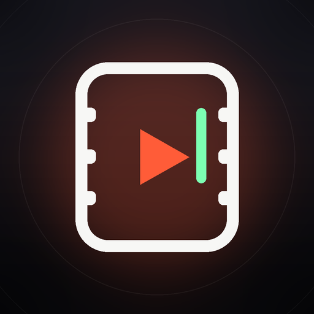
  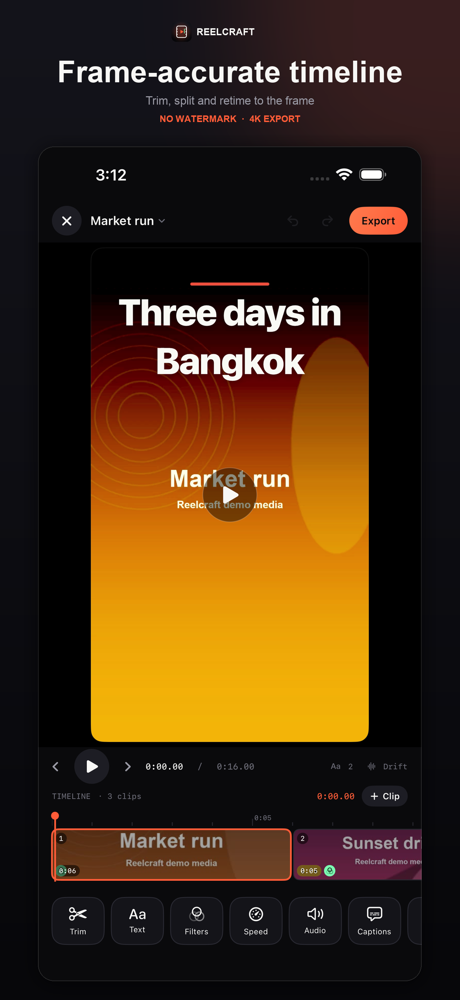
  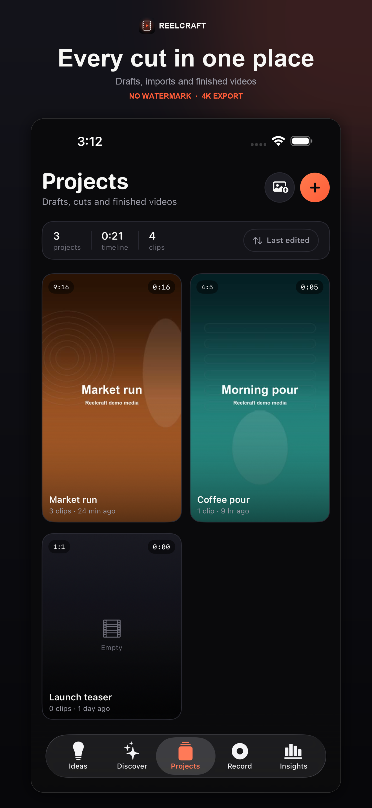
  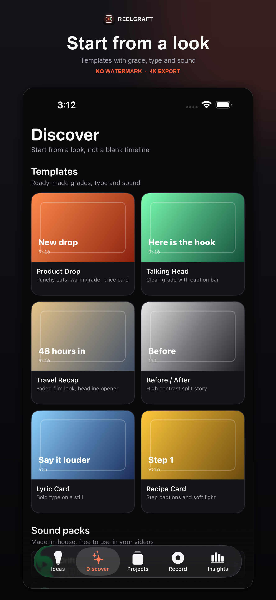
</p>

<!-- Marketing/screens-max/ holds the raw captures this pair of scripts produces. -->
<p align="left">
  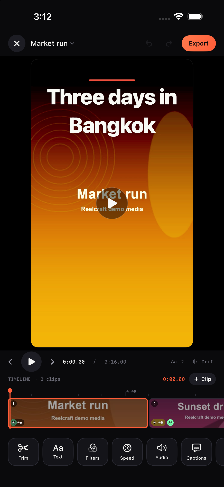
  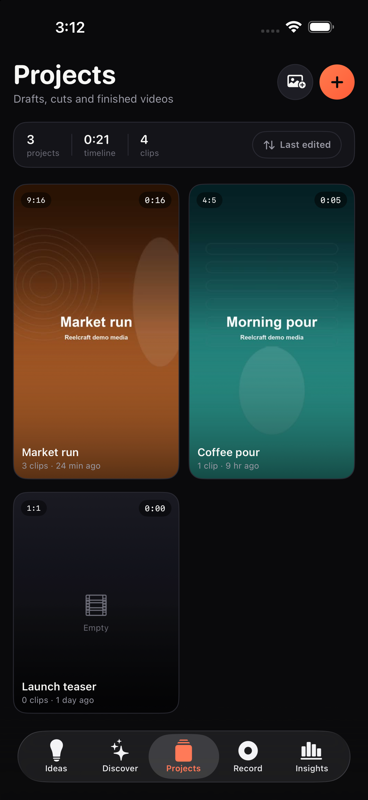
  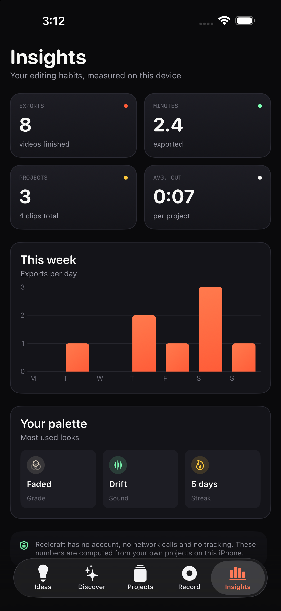
  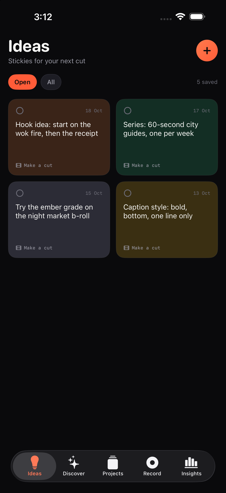
</p>

## What it does

| Area | Shipped |
| --- | --- |
| Projects | Library grid, poster frames, sort, rename, duplicate, delete, project stats |
| Editor | Multi-clip timeline, in/out trim, split at playhead, reorder, duplicate/delete, frame stepping, undo/redo |
| Look | 8 Core Image grades per clip, apply-to-all, timeline badges |
| Text | Overlays with 4 styles, 3 positions, 5 colours, start/length timing |
| Audio | Per-clip volume and mute, 4 in-house music beds looped with a fade, music level |
| Captions | On-device speech-to-captions, editor list, manual captions, 4 caption styles |
| Frame | 9:16, 4:5, 1:1, 16:9 with centre-crop fill |
| Export | 1080p or 4K, no watermark, save to Photos, share sheet |
| Capture | In-app camera with 10-minute cap, flip, torch, recording → project |
| Ideas | Sticky board with colours, done state, convert a note into a project |
| Discover | 6 templates that set frame, grade, type and sound; sound-pack previews |
| Insights | Local exports, minutes, project stats, weekly chart, most-used grade/sound |

No account, no networking, no third-party SDKs.

## Screenshots

App Store frames (1320 × 2868), captured from the running app on an iPhone 17 Pro Max simulator:

<p align="left">
  
  
  
  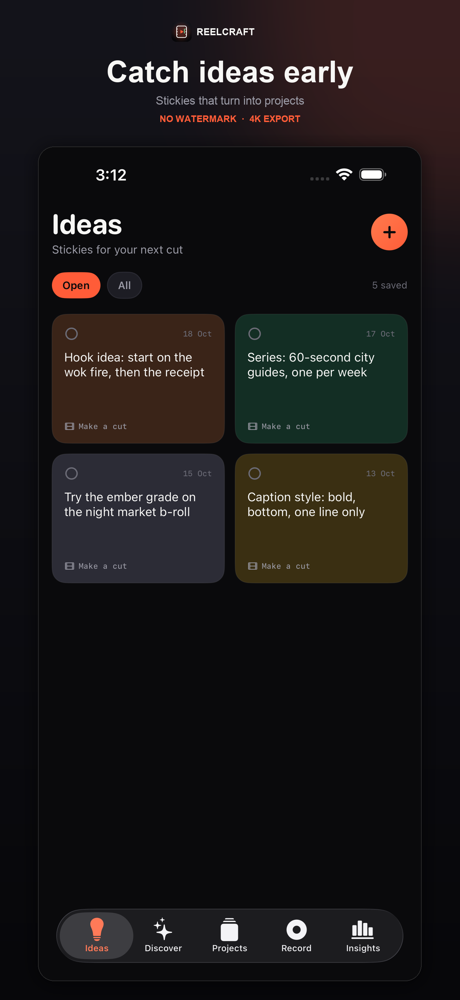
  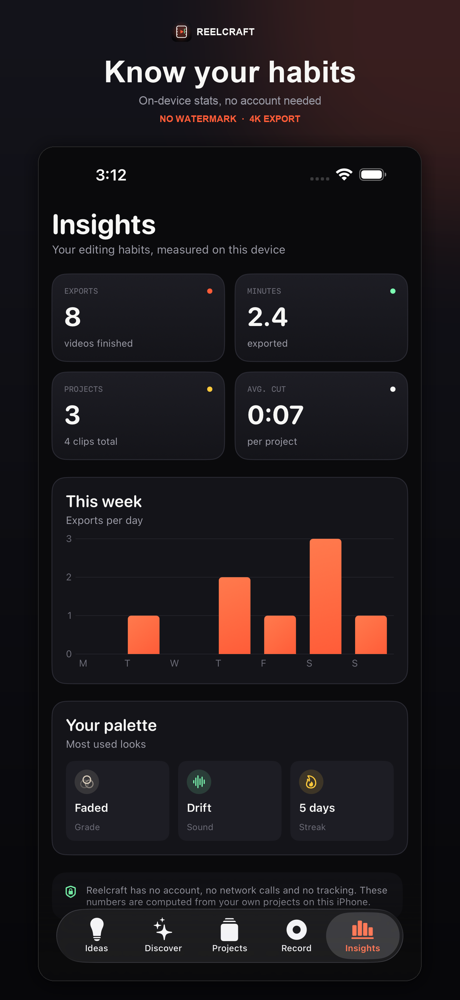
</p>

Icon, feature graphic and the raw device captures:

<p align="left">
  
  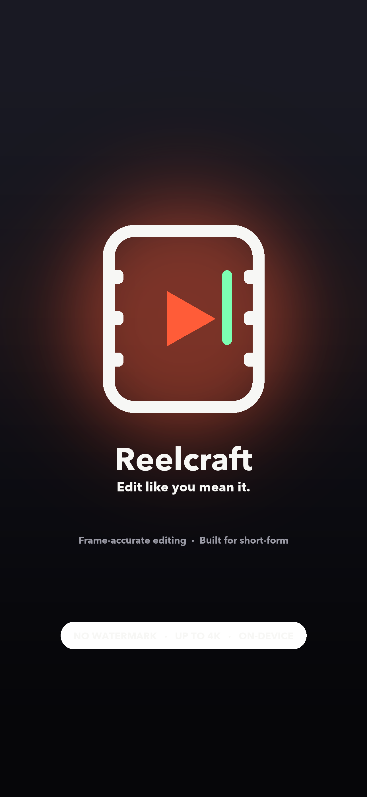
  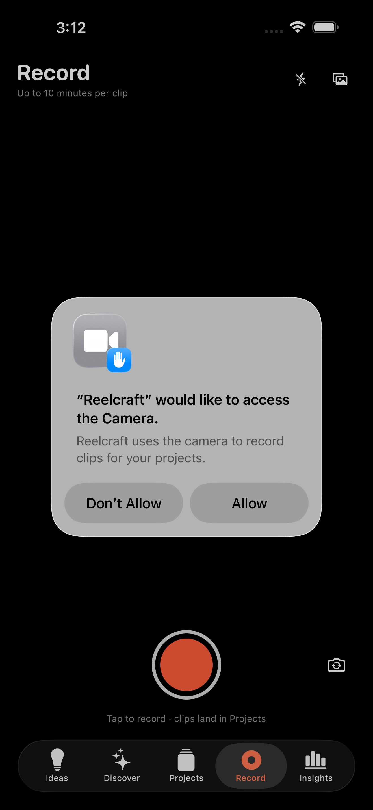
  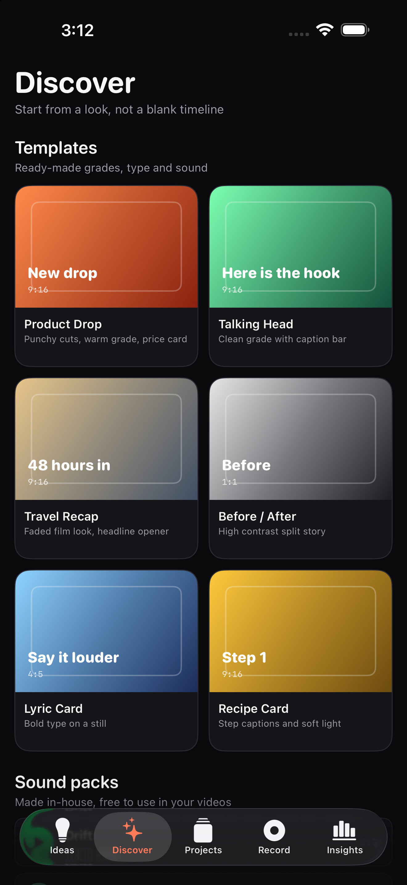
</p>

Every path above is checked by `python3 tools/check_readme_links.py` before each push, so a renamed asset cannot quietly turn into a broken image.

## Requirements

- macOS with Xcode 27 or newer (built and tested with Xcode 27.0 / Swift 6.4).
- [XcodeGen](https://github.com/yonaskolb/XcodeGen) (`brew install xcodegen`) — the Xcode project is generated, not committed by hand.
- iOS 17.0+ deployment target, iPhone only.
- Python 3.9+ with Pillow, plus `ffmpeg` and `afconvert`, only if you regenerate assets or capture screenshots.

## Build and run

```bash
cd reelcraft
xcodegen generate
open Reelcraft.xcodeproj          # then ⌘R
```

From the command line:

```bash
xcodebuild -project Reelcraft.xcodeproj -scheme Reelcraft \
  -destination 'platform=iOS Simulator,name=iPhone 17 Pro' build
```

## Test

```bash
xcodebuild -project Reelcraft.xcodeproj -scheme Reelcraft \
  -destination 'platform=iOS Simulator,name=iPhone 17 Pro' test
```

`ReelcraftTests/RenderPipelineTests.swift` writes real clips with `AVAssetWriter` and checks the parts that are easy to get wrong: trims plus speed produce the right timeline duration, the composition carries a filter/overlay/audio setup, and export writes a playable 1080 × 1080 mp4 whose duration and dimensions match the project.

## Regenerate the assets

```bash
python3 tools/make_assets.py      # app icon + marketing wallpaper
python3 tools/make_music.py       # four 24-second music beds (AAC)
```

## Screenshots and store art

```bash
xcrun simctl boot "iPhone 17 Pro Max"
xcrun simctl install booted "$(xcodebuild -project Reelcraft.xcodeproj -scheme Reelcraft -showBuildSettings -destination 'generic/platform=iOS Simulator' | awk '/TARGET_BUILD_DIR/{d=$3} /WRAPPER_NAME/{w=$3} END{print d"/"w}')"
python3 tools/seed_simulator.py booted                    # demo projects, ideas, exports
bash tools/capture_screens.sh booted Marketing/screens-max
python3 tools/make_store_screens.py                       # 1320x2868 App Store frames
```

The debug build understands `-startTab <ideas|discover|projects|record|insights>` and `-openFirstProject`, which is how the screenshots above were captured without touching the UI by hand. Those flags are compiled out of release builds.

## Project layout

```
reelcraft/
  project.yml                 XcodeGen spec (bundle id, version, Info.plist keys, test target)
  Reelcraft/
    App/                      entry point, 5-tab shell, router
    Design/                   tokens and UI primitives
    Models/                   project, clip, overlay, filter, template, idea
    Store/                    JSON persistence and container paths
    Media/                    import, composition builder, overlay renderer, exporter
    Features/                 Projects, Editor, Camera, Ideas, Discover, Insights
    Resources/Sounds/         generated music beds
  ReelcraftTests/             render pipeline tests
  tools/                      assets, music, screenshots, preflight and listing checks
  Marketing/                  icon, wallpaper, screenshots, App Store frames, privacy page
  replica/                    recon, architecture, brand, build log, feature matrix, listing
```

## Shipping to the App Store

Everything here is ready; the remaining steps need your Apple account. Run the whole chain before you touch App Store Connect:

```bash
bash tools/preflight.sh
```

It checks every local doc link, lints the store listing, runs the four render tests, and archives a Release build for iPhone — signed and exported to an IPA when a Team ID is present, unsigned otherwise. [`SUBMISSION.md`](SUBMISSION.md) is the paste-ready App Store Connect answer sheet: app record fields, privacy answers, review notes and the TestFlight checklist.

1. **Apple Developer Program** — enrol, then note your **Team ID**.
2. **Bundle identifier** — either keep `com.reelcraft.app` or change it in `project.yml` (`PRODUCT_BUNDLE_IDENTIFIER`), then register it in [Certificates, Identifiers & Profiles](https://developer.apple.com/account/resources/identifiers).
3. **Signing** — put your Team ID in `project.yml` under `DEVELOPMENT_TEAM` (or set it in Xcode → Signing & Capabilities), then run `xcodegen generate` again.
4. **Archive**
   ```bash
   xcodebuild -project Reelcraft.xcodeproj -scheme Reelcraft \
     -destination 'generic/platform=iOS' -archivePath build/Reelcraft.xcarchive archive
   ```
   Validate the unsigned compile first if you want:
   ```bash
   xcodebuild -project Reelcraft.xcodeproj -scheme Reelcraft \
     -destination 'generic/platform=iOS' -archivePath build/Reelcraft.xcarchive \
     CODE_SIGNING_ALLOWED=NO archive
   ```
5. **App Store Connect** — create the app record (name *Reelcraft*, primary language, category **Photo & Video**, bundle ID from step 2).
6. **Metadata** — paste from `replica/launch/listing.json`: title, subtitle, promotional text, description, keywords, what's new.
7. **Screenshots** — upload the five 1320 × 2868 files in `Marketing/appstore/` to the 6.9-inch slot.
8. **Privacy** — App Privacy answers: **Data not collected**. Privacy policy URL: host `Marketing/privacy.html` on any domain (or use Sites/any static host) and paste the URL.
9. **Age rating** — 4+. No user-generated content sharing, no ads, no in-app purchases in v1.
10. **Encryption** — the app declares `ITSAppUsesNonExemptEncryption = false`, so no export-compliance prompt.
11. **Upload** — Xcode → Organizer → Distribute App → App Store Connect → Upload. Then TestFlight it to yourself on a real iPhone.
12. **Test on device before submitting**: camera recording, captions (needs the on-device speech model), 4K export timing on a long clip.
13. **Submit for review.**

## Known limits (read before submitting)

- **Camera capture is unverified on hardware.** It builds against AVFoundation and was exercised for session setup only; the simulator has no camera. Test it on a phone.
- **Auto captions depend on Apple's on-device speech model.** If it is not installed, the UI shows a clean message instead of captions.
- **4K export** renders at 2160-class sizes and is slow on older phones for long timelines. Copy says "up to 4K".
- **Not built on purpose:** Instagram sign-in, saved reels/collections, discovery feed with licensed audio, account analytics, licensed stickers/fonts/GIFs. Those belong to the original app's network and licences.
- The name **Reelcraft** needs a trademark and domain check before you sell anything (list in `replica/brand.md`).

Details and evidence: [`replica/recon.md`](replica/recon.md), [`replica/architecture.md`](replica/architecture.md), [`replica/build-log.md`](replica/build-log.md), [`replica/brand.md`](replica/brand.md), [`replica/launch/launch.md`](replica/launch/launch.md), [`PRIVACY.md`](PRIVACY.md).

## Licence

Your project. The music beds, icon and wallpaper were generated by the scripts in `tools/`, so they are yours to ship.
